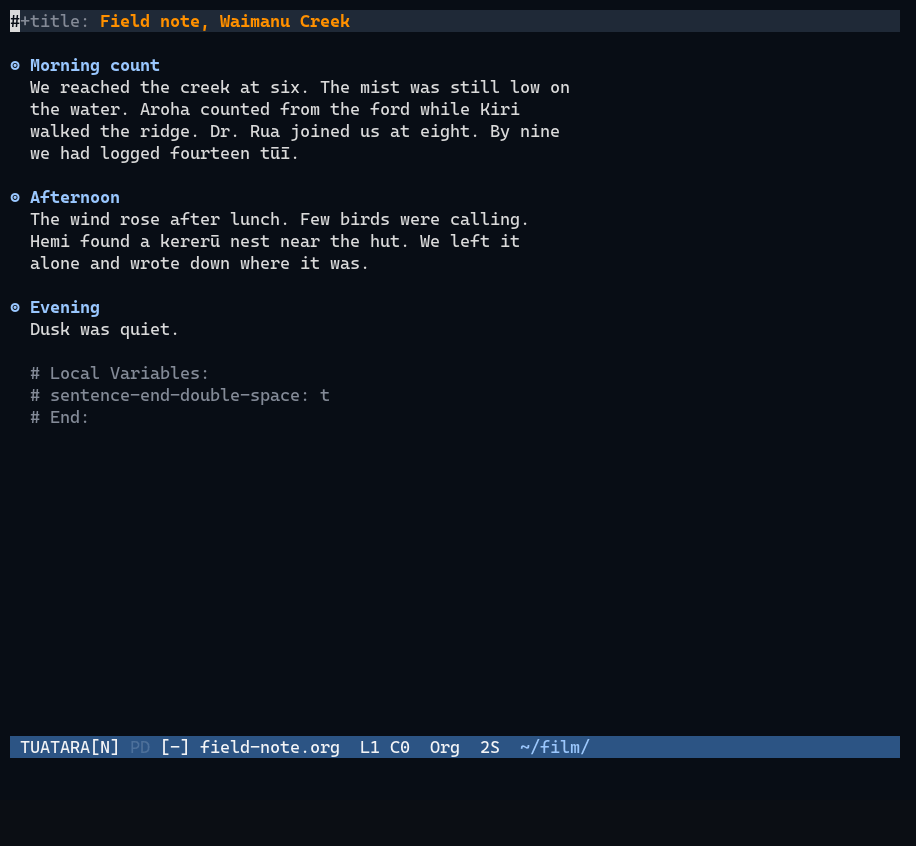

# garamond

Read the manual:
[tuatara-editor.github.io/tuatara-garamond](https://tuatara-editor.github.io/tuatara-garamond/).

One space or two after a full stop, kept by the document itself.

How far apart sentences are is a property of a document, so the document says
it in its own `Local Variables:` block:

```
# Local Variables:
# sentence-end-double-space: t
# End:
```

A file that says nothing is left alone. Typing, filling and the sentence
commands then follow the spacing the file asks for. One of the Tuatara
project's packages, not part of the editor.

The manual says how to set the spacing of a buffer and change a text to match,
what typing does and where a second space goes, and lists every command and
setting.

<picture>
  <source media="(prefers-color-scheme: light)" srcset="media/garamond-light.gif">
  
</picture>

## What it needs

- Tuatara 0.90.25 or later.
- No other program.

## Installing it, step by step

1. **Open your init file**: in Tuatara press `C-x C-f`, type
   `~/.config/tuatara/init.lisp` and press `RET`.
2. **Add this line** to it:

   ```lisp
   (load-package "garamond" :source "https://github.com/Tuatara-Editor/tuatara-garamond")
   ```

3. **Save** with `C-x C-s`, **quit** with `C-x C-c`, and **start Tuatara
   again**. Answer `y` when it asks whether to load garamond; it asks once.
4. **Check it**: open a file with a `Local Variables:` block saying
   `sentence-end-double-space: t`; the mode line shows `2S`.

## On a machine without internet

Tuatara compiles the package itself, so only fetching it needs the internet.
On a machine with internet:

```sh
git clone https://github.com/Tuatara-Editor/tuatara-garamond
git -C tuatara-garamond verify-tag "$(git -C tuatara-garamond describe --tags --abbrev=0)"
```

Copy the directory to the other machine, for instance to
`~/tuatara-packages/tuatara-garamond`, and name it in the init file:

```lisp
(load-package "garamond" :source "~/tuatara-packages/tuatara-garamond")
```

Carrying over the compiled files as well, so the other machine skips the
compiling, is in Tuatara's manual, chapter 19, "On a machine without
internet".

## Credits

Made from the Emacs package of the same name, by Michael A Jones:
[github.com/YardQuit/garamond](https://github.com/YardQuit/garamond).

## License

GPL-3.0-or-later; see `LICENSE` at the top of this repository.

## Working on it

```sh
tools/test.sh
```

runs its tests against a Tuatara source tree: `../tuatara` beside this
repository, or `../../tuatara` beside the directory it is in, unless
`TUATARA_SOURCE` names another. How a package is laid out and which of
Tuatara's names it may use are in Tuatara's
[HACKING.org](https://github.com/Tuatara-Editor/tuatara/blob/main/HACKING.org);
bug reports, ideas and how changes are made in
[CONTRIBUTING.md](CONTRIBUTING.md). The manual's source is in `doc/manual/`;
`tools/manual-html.sh` in a Tuatara tree, given this repository's directory,
makes its pages.
